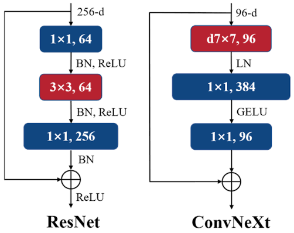
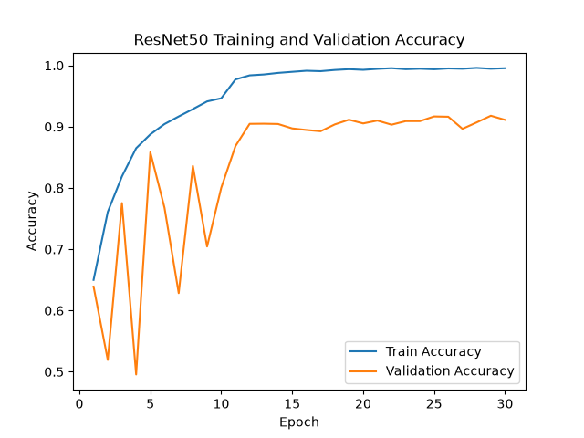
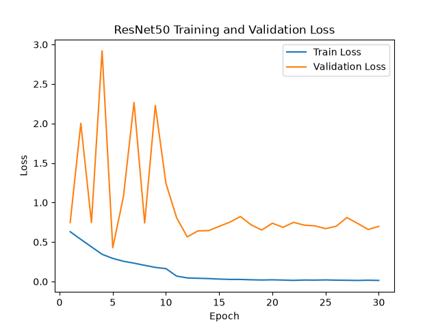
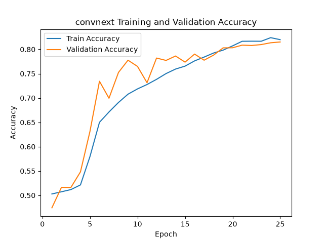
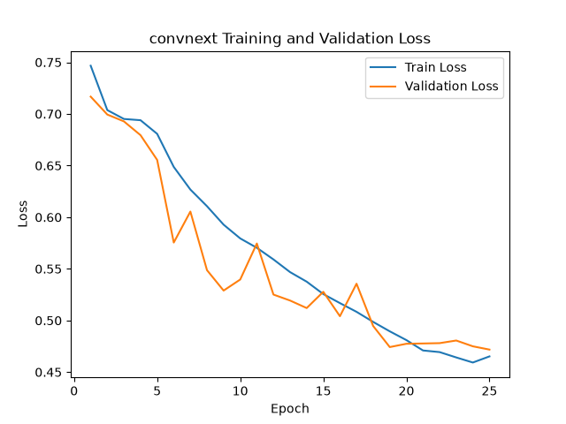

# Alzheimer’s Disease Classification Between ConvNeXt And ResNet50

This report investigates CNN architectures for binary classification of Alzheimer’s Disease using the ADNI image dataset.

The primary model is a custom implementation of ConvNeXt, with ResNet50 implemented as a baseline for comparison.

ConvNeXt is a modern CNN that build on top of the classic ResNet. It incorporates the architectural advancements of Vision Transformers. It modernised ResNet by using the same design choices, macro-structures, and training techniques that are used in Vision Transformers. Using this architectural design, it allowed for a CNN that matches transformer accuracy, whilst keeping the efficiency, simplicity and strong inductive bias of a CNN.

The baseline model is ResNet50 [1], a deep CNN built around residual connections. ResNet50 uses bottleneck blocks 3 layers of convolutions are used. A beginning 1x1 convolution that reduces the channel count, a 3x3 convolution to perform spatial processing and a final 1x1 convolution to expand the channels again. They all use BatchNorm and ReLu activations throughout. It begins with a 7x7 stride-2 convolution and max pooling with the blocks [3, 4, 6, 3]. Resolution is halved and channels double widths at each stage. It ends with adaptive average pooling and a linear classifier. ConvNeXt keeps a similar macro-structure of four stages and residual blocks, but follows the design choices of Vision Transformers. A 4x4 stride 4 stem with a 7x7 depthwise convolution instead of the 3x3 convolution. Am inverted bottle neck expands the channels inside the block instead of narrowing them, GELU activation block, LayerNorm instead of BatchNorm, and other training aids such as layer scale and stochastic depth. 

### Architecture for ResNet50 and ConvNeXt [2]


#### ConvNeXt
```
class ConvNeXt(nn.Module):
	def __init__(
		self, 
		in_channels = 1,
		num_classes=2, 
		depths=(3, 3, 9, 3), 
		dims=(96, 192, 384, 768), 
		drop_path_rate=0.1
	):
```

## Feasbility Report
### User Need, Scope & Acceptance Criteria
The intended users for this would be clinical or research reviewers assessing Alzheimer’s screening. The prototype would classify ADNI brain MRI images into AD vs CN. It will also produce confidence scores that may help identify uncertain cases for further review. This project will compare ConvNeXt against a CNN baseline using the same data splits. 
Acceptance Criteria:
•	At least a 0.80 test accuracy
•	Continue patient-independent train, validation and test splits
•	Compare the difference between ConvNeXt with A CNN using accuracy, precision, recall, etc.
•	Measure parameter count, GPU memory and inference time.

### Model Choice & Course Concepts
ConvNeXt was selected to be used to compare against the CNN architecture. The ConvNeXt model is listed as a Hard Difficulty model. A basic CNN will be used as a baseline to compare the ConvNeXt and evaluated using the same metrics. Convolutional feature extraction, overfitting, classification metrics, and other course related content will be useful when comparting baseline models using the same data.

### Preliminary Feasibility Evidence
The ADNI dataset contained 30520 MRI slices with the training set containing 21520 slices (10400 AD and 11120 CN), while the test set contained 9000 slices (4460 AD and 4540 CN).  A simple CNN was ran with 23714 trainable parameters and completed a 20-batch CUDA smoke test. The average loss was 0.6938, with training times of 0.93 seconds, and a peak allocated GPU memory of around 0.190GB

### Risks, Budget & Fallback
Some risks include overfitting and higher computational cost of ConvNeXt. Validation checks, augmentation, regularisation and potential early stopping might be used to prevent these risks.

The first task is to train a baseline CNN model for precision, accuracy, recall, etc, before running ConvNeXt on the same splits. If ConvNeXt exceeds available resources then batch size, input resolution or model size will be reduced.

Patient IDs will be used to ensure that slices from the same patient do not appear across training, validation and test set. The training and test datasets will also be checked for potential patient-level data leakage to ensure that slices from the same patient are not present across multiple data splits.

## Project Structure
### Dataset
Dataset.py is responsible for locating the ADNI dataset, extracting patient IDs, constructing patient-level training and validation splits, loading the supplied test set, image preprocessing, data augmentation, creation of PyTorch Dataset and DataLoader objects.

### Modules
Modules.py  implements ResNet50, ResNet50 Bottleneck Block, ConvNeXt block, LayerNorms, Stochastic Depth, and ConvNeXt.

### Train
Train.py handles training and evaluating the model; implementing optimisation, validation, checkpoint selection, early stopping, metric calculations, resource measurement.

### Predict
predict.py uses the saved model to use on individual MRI images.

## Dataset
The dataset was downloaded into the directory /recognition/ConvNeXt_s4889745/ADNI.

The dataset contains two classes:
- AD = 0
- NC = 1

The data was separated into:
ADNI/
└── AD_NC/
    ├── train/
    │   ├── AD/
    │   └── NC/
    │
    └── test/
        ├── AD/
        └── NC/

The supplied test directory is kept separate from model training. The train data is split and ensured that there is no overlap between train and validation datasets.

### Training, Validation and Test Split
As the dataset contain multiple MRI slices of the same patient, a normal random image level split would create a risk of causing patient level data leakage. To prevent this, the patient identifier is gathered from the file name with it being the first set of numbers. The supplied training data set was then divided into a patient level split of 80/20 with the split being training and validation respectively. 

The splits were:

| Split      | Patients | Images | AD   | NC   |
| ---------- | -------- | ------ | ---- | ---- |
| Training   | 861      | 17 220 | 8320 | 8900 |
| Validation | 215      | 4300   | 2080 | 2220 |
| Test       | 450      | 9000   | 4460 | 4540 |
## Dependencies
Ensure appropriate libraries are installed. 
	torch 2.14.1+cu130
	torchvision 0.29.1+cu130
	numpy 2.5.4
	Pillow 12.3.0
	matplotlib 3.11.2
	scikit-learn 1.9.1

## Reproducibility
The patient-level training and validation split uses a fixed random seed of 42. This means that the same patient IDs are assigned to the same training and validation groups each time the dataset is loaded.

For both ConvNeXt and ResNet50:
- training, validation and test patient partitions
- image resolution
- batch size
- input representation
- evaluation metrics
- test dataset
are used.

## Example Inputs and Outputs
### Example Inputs
The model takes a grey-scale of an MRI slice as input. An ADNI image has the dimension 256 x 240 pixels and an example filename "264355_53.jpeg" where "264355" is the patient identifier and the other number is the image slice. During preprocessing, the image is converted into grey-scale and resized to 1 x 244 x 244.

To classify an image, predict.py can be run.

### Example Output
A prediction outputs a class label and the probabilities of the two classes:
```
Prediction Results

Predicted class: NC
Confidence: 0.9511
AD probability: 0.0489
NC probability: 0.9511
```

# Analysis
The importance of this report was to determine whether or not if the addition complexity of ConvNeXt would provide an advantage over the ResNet50 baseline for Alzheimer's Disease classification, and whether or not the model confidence can be trusted when deciding which prediction may need human review.

Both models were evaluated using the same patient test split and the same preprocessing and evaluation metrics.
## Quantitative benchmarking

| Metric          | ResNet50 | ConvNeXt |
| --------------- | -------- | -------- |
| Test Accuracy   | 0.7501   | 0.7112   |
| Macro Precision | 0.7873   | 0.7227   |
| Macro Recall    | 0.7485   | 0.7102   |
| Macro F1        | 0.7409   | 0.7068   |
| AUROC           | 0.8347   | 0.7829   |
| AD Precision    | 0.8886   | 0.7710   |
| NC Precision    | 0.6861   | 0.6743   |
| AD Recall       | 0.5668   | 0.5935   |
| NC Recall       | 0.9302   | 0.8269   |
As demonstrated in the results, ResNet50 produced stronger result compare to ConvNeXt with the test accuracy being 75.01% compared to 71.12%. It is also shown that ResNet50 had a higher Macro F1 and AUROC, indicating a stronger discrimination between AD and NC.
### ResNet50 Confusion Matrix
```
True AD predicted AD: 2528 
True AD predicted NC: 1932 
True NC predicted AD: 317 
True NC predicted NC: 4223
```

### ConvNeXt Confusion Matrix
```
True AD predicted AD: 2647 
True AD predicted NC: 1813 
True NC predicted AD: 786 
True NC predicted NC: 3754
```

As seen though both confusion matrices, there is higher recall for NC than AD. This means that AD to NC false negatives are a significant weakness. 

## Training and Validation Performance
The best model was selected using validation balance accuracy instead of normal validation accuracy. This was to allow for equal importance between the AD and NC classes. 30 epochs were ran but if the validation balance accuracy did not improve for 10 consecutive epochs, then it would stop early.
### ResNet50
```
Best validation balanced accuracy: 0.9210
Best epoch: 15
Epochs completed: 25
```

### Training Curves
#### ResNet50 training and validation accuracy


As show in the accuracy curve, ResNet50 learned the training data quickly, whilst it approached 1.0. The validation accuracy was steadily increasing whilst bouncing between 0.5 and 0.85, but became more stable at around 12 epochs approaching 0.9 accuracy. This gape between the training and validation accuracy indicates the the training data was fitted more coley compared to the unseen validation data.

#### ResNet50 training and validation Loss


The training loss continued to decrease throughout the training, whilst the validation loss was more inconsistent.  This is a strong sign of overfitting. 

### ConvNeXt
```
Best validation balanced accuracy: 0.8522
Best epoch: 25
Epochs completed: 30
```

#### ConvNeXt training and validation accuracy


ConvNeXt training accuracy slowly increase throughout the 30 epochs reaching around 0.98. Validation accuracy peaked at 0.85. The two curves remained relatively similar throughout training. This demonstrates that ConvNeXt was able to learn useful features from the training data while maintaining reasonable generalisation to the validation set.

#### ConvNeXt training and validation Loss


ConvNeXt training consistently decreased throughout training, whilst validation loss demonstrated some fluctuations but also generally followed the training loss. The small difference between the two curves suggests that there was mild overfitting.
## Comparison of Training Behaviour
As show through the accuracy and loss of both ResNet50 and ConvNeXt, ResNet50 provided a higher validation accuracy, but also showed a larger gap between training and validation performance. ConvNeXt, was slower to train but maintained a closer training and validation curve, suggesting a more stable generalisation.

Although ConvNeXt demonstrate a better generalisation, ResNet50 still achieved the stronger final test. This demonstrates that the overfitting in the training curves did not necessarily caused for a better test set accuracy for ConvNeXt.

## Confidence and Ambiguity
Prediction confidence was also used to investigate whether incorrect predictions could be identified by lower SoftMax confidence.
### ResNet50
```
Average confidence when correct: 0.9879 
Average confidence when incorrect: 0.9596
```
### ConvNeXt
```
Average confidence when correct: 0.9285 
Average confidence when incorrect: 0.9039
```

As seen in both neural networks, the prediction confidence does not reliably distinguish correct predictions form incorrect ones. ResNet50 produces a average confidence of 95.96% even when the prediction was wrong.

A confidence based rejection system should not be used to determine whether or not a prediction requires human review.

## Resource Profiling
Both models measured the computational efficiency using count, peak GPU memory, inference latency, training time, validation time and full test evaluation time.

| Resource                       | ResNet50      | ConvNeXt      |
| ------------------------------ | ------------- | ------------- |
| Trainable Parameters           | 23 505 858    | 27 818 594    |
| Peak GPU VRAM                  | 275.59MB      | 302.94MB      |
| Inference Latency              | 1.281ms/image | 1.447ms/image |
| Average Training Time / Epoch  | 48.67s        | 60.31s        |
| Total Training Time            | 1216.65s      | 1809.33s      |
| Average Validation Time/ Epoch | 9.76s         | 10.72s        |
| Total Validation Time          | 244.01s       | 321.74s       |
| Full Test Evaluation Time      | 28.08s        | 24.71s        |
RestNet50 contained around 4.3 million less parameters and required less GPU VRAM.

## Qualitative Failure Case 
Several failure cases were identified:
### Failure case 1: Missed AD cases (false negatives)
Both models misses a large amount of AD slices. ResNet50 classified 1,932 of 4,460 AD slices as NC (43.3%), and ConvNeXt classified 1,813 (40.7%). This presents a dangerous error, as a missed AD case would receive no further review. This is also the opposite to the training behaviour. Both models reached around a 98% training accuracy, so failure to generalise rather than failure to learn classes.
### Failure case 2: AD predicted as NC
1439612_105.jpeg was incorrectly classified as NC even though the true class was AD. The image may contain only subtle structural changes, causing the model to rely on features that resemble the NC class. This represents the most common failure mode observed in the test results and is important because it corresponds to an AD false negative.
### Failure Case 3: NC predicted as AD
1291468_104.jpeg was incorrectly classified as AD. The model may have responded to image characteristics that it had learned to associate with AD. This shows that some visual features are shared between classes and can lead to false-positive predictions.

## Engineering Recommendation
As shown through the experimental results, ResNet50 is recommended over ConvNeXt for the current prototype. 

ResNet50 has achieved a higher:
- test accuracy
- Macro Precision
- Macro Recall
- Macro F1
- AUROC

and also requires:
- fewer trainable parameters
- less GPU VRAM
- lower inference latency
- less training time per epoch

Although ConvNeXt achieved a slightly higher AD recall, the improvement was not substantial enough to offset the lower overall test performance and greater computational requirements.

The additional architectural complexity of ConvNeXt therefore did not provide a sufficient performance increase over the ResNet50 baseline implementation.

However, both models should not be recommended for classifying Alzheimer disease. 

Both models demonstrated:
- low AD recall
- substantial AD to NC false negatives
- high confidence when incorrect
- a significant validation and test generalisation gap
- neither reached the 0.8 acceptance rate

I would recommend to retain ResNet50 as it demonstrated to be the more efficient baseline architecture, but focusing on improvement on the data representation and decision reliability over increasing the model complexity

Possible next engineering steps include:
- patient-level probability aggregation across the 20 slices
- confidence calibration
- class-specific decision thresholds
- investigation of high-confidence false negatives
- patient-level cross-validation
- external dataset validation
## References

[1]
Z. Liu _et al._, ‘A ConvNet for the 2020S’, Mar. 2022. Accessed: Oct. 30, 2026. [Online]. Available: https://arxiv.org/pdf/2201.03545

[2]
M. Zhao, X. Xu, X. Bao, X. Chen, and H. Yang, ‘An Automated Instance Segmentation Method for Crack Detection Integrated With CrackMover Data Augmentation’, _Sensors_, vol. 24, no. 2, p. 446, Jan. 2024, doi: 10.3390/s24020446.

## Artificial Intelligence Usage Disclosure
I used ChatGPT GPT-5.6 Sol

### AI assistance
- Helped develop inital structure and polished README
- Refactored code and provided debugging
- Explained unknown concepts to help in creating the models
- Summarised research documents
- plotting code was generated by ai

### Audit
- Code was only used if understood
- A background search was used to confirm the correctess of the answer
- Testing was done in a separate file to ensure that original code was not disrupted


